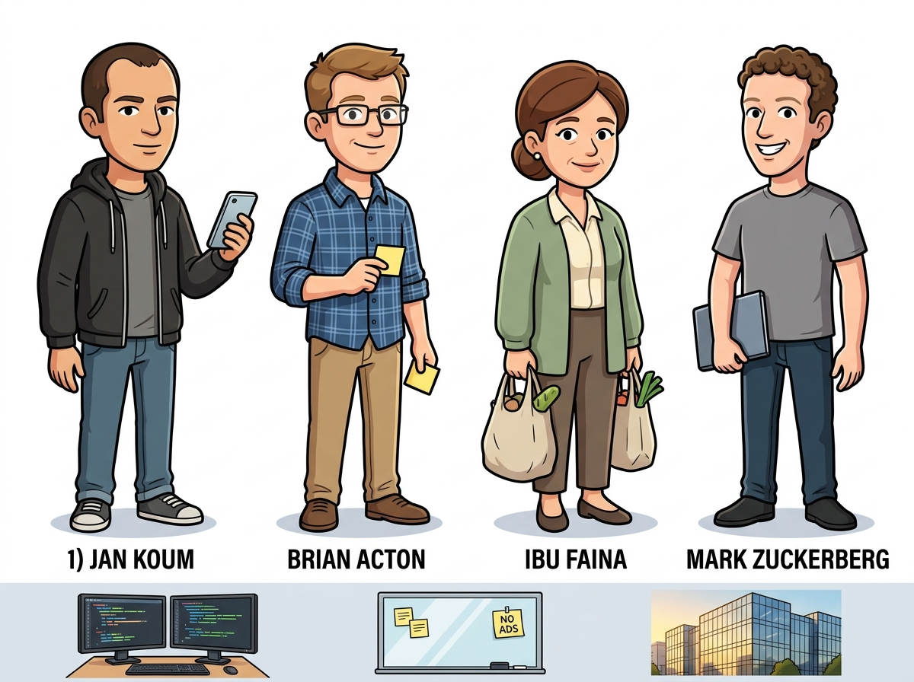

# Rancangan Produksi: Kisah Nyata Jan Koum — Pendiri WhatsApp (2014)

- **Judul Kerja:** Dari Antre Kupon Makanan hingga Menjual WhatsApp Rp 280 Triliun (\$19 Miliar)
- **Format:** Vertikal `1080×1920`, `30 fps`, target durasi **~135 detik (2 menit 15 detik / ~4.050 frame)** — pas di atas syarat minimal 2 menit dan aman untuk YouTube Shorts (maks 3 menit), TikTok, & Reels.
- **Gaya Visual:** **Hybrid 2.5D Modern Profesional** — 4 latar 3D **Blender Headless** super detail & padat properti modern + karakter **2D Cutout Upgraded** (artikulasi sendi 2-ruas, siklus jalan mulus, kedip & gerak mata dinamis, transisi pose cair) + **kamera dinamis non-stop** (Catmull-Rom spline, orbit, parallax, crane, fly-through, gimbal micro-motion).
- **Audio & Suara:** Kloning suara natural **`dodi`** (Narator, Jan Koum, Brian Acton, Mark Zuckerberg dengan diferensiasi intonasi/gaya) & **`ara`** (Ibu Faina & HR Recruiter) via `pocket-tts-indonesian` + SFX modern (klik keyboard mekanikal, notifikasi pesan, langkah sepatu, pintu kaca, tanda tangan pena) + musik latar sinematik modern ducking.

---

## 1. Fakta Sejarah & Sumber Inti
- **1992 (Mountain View, California):** Jan Koum (16 tahun) pindah dari Kyiv, Ukraina bersama ibunya, Faina. Mereka tinggal di apartemen subsidi kecil dan mengantre kupon makanan (*food stamps*) di kantor dinas sosial Mountain View. Jan menyapu lantai toko kelontong sambil belajar pemrograman dari buku jaringan komputer bekas.
- **2009 (Penolakan Facebook & Twitter):** Setelah resign dari Yahoo, Jan Koum dan sahabatnya Brian Acton melamar kerja ke Facebook dan Twitter — keduanya ditolak. Brian menulis tweet legendaris (3 Agustus 2009): *"Facebook turned me down. Looking forward to life's next adventure."*
- **2009–2013 (Lahirnya WhatsApp):** Terinspirasi App Store di iPhone barunya, Jan membuat WhatsApp agar orang bisa berkirim pesan tanpa biaya mahal dan tanpa gangguan. Brian menempelkan catatan legendaris di meja Jan: **"No Ads! No Games! No Gimmicks!"** Tanpa biaya iklan, pengguna WhatsApp melesat hingga **450 juta pengguna aktif** hanya dengan ~55 karyawan.
- **19 Februari 2014 (Akuisisi \$19 Miliar):** Facebook mengakuisisi WhatsApp senilai **\$19 miliar**. Jan Koum sengaja memilih menandatangani berkas kesepakatan di depan pintu gedung kantor dinas sosial Mountain View — tempat yang sama di mana ia dan ibunya dulu mengantre kupon makanan.

---

## 2. Lembar Karakter & Desain Visual

| Tokoh | Gender & Suara | Ciri Visual & Pakaian Berdetail | Ekspresi yang Digunakan |
| --- | --- | --- | --- |
| **Jan Koum** | Pria (`dodi`) | Rambut cepak cokelat tua, hoodie zip-up charcoal gelap di atas kaos abu-abu, tali hoodie, resleting, celana jeans lipatan rapi, sneakers modern | Tenang serius, lelah/frustrasi, fokus coding, terkejut, haru/tersenyum bangga |
| **Brian Acton** | Pria (`dodi` hangat) | Kacamata persegi tipis, rambut cokelat muda rapi, kemeja flanel kotak biru kerah rapi, celana chino krem, sepatu kasual cokelat | Ramah menyemangati, cengengesan tabah, antusias penuh semangat, terharu bangga |
| **Ibu Faina** | Wanita (`ara`) | Rambut cokelat disanggul rapi, anting mutiara kecil, kardigan hijau sage di atas blus krem berkerah, celana cokelat, flat shoes | Lembut penuh kasih, lelah tapi tegar, senyum bangga |
| **Mark Zuckerberg** | Pria (`dodi` tegas) | Rambut keriting cokelat pendek khas, kaos polos abu-abu *heather* ikonik, celana jeans gelap, sneakers minimalis | Fokus analitis, antusias bersemangat, senyum respek saat negosiasi |
| **HR Recruiter & Figuran** | Wanita (`ara`) & Figuran | Blazer modern biru/abu, kemeja kerja Silicon Valley, antrean warga & developer di kantor startup | Profesional datar (HR), sibuk mengetik (developer) |

### Upgrade Rigging Karakter Mulus (`src/whatsapp/rig2d.ts`)
- **Artikulasi 2-ruas:** bahu → siku → pergelangan + jari/genggaman (halus saat mengetik, mengulurkan map, memegang cangkir kopi, menempel sticky note, menjabat tangan, menandatangani kontrak).
- **Siklus jalan mulus (*walk cycle*):** ayunan paha-lutut-sepatu, ayunan lengan berlawanan, dan pantulan vertikal lembut saat karakter melangkah.
- **Wajah hidup:** kedip mata otomatis natural, pergerakan pupil mengikuti lawan bicara/layar, alis elastis, pernapasan dada (*torso breathing*), serta *lip-sync* responsif terhadap waktu suku kata.

---

## 3. Lembar Properti 3D Modern Profesional (4 Set Blender `.glb`)

Semua set dibangun lewat skrip Blender headless dengan **material batching** agar kaya properti tapi tetap cepat dirender:

1. **Set A — Gedung Dinas Sosial Mountain View & Ruang Tunggu Modern (`wa_exterior_welfare.glb`)**
   - **Eksterior:** Gedung arsitektur modern fasad beton bersih + dinding kaca reflektif bertingkat, kanopi baja depan pintu kaca otomatis, papan nama modern `"SOCIAL SERVICES · MOUNTAIN VIEW"`, tangga + railing stainless, lampu jalan LED, planter beton + pohon rindang, bangku modern, mobil sedan parkir, trotoar kota Silicon Valley + gedung perkantoran kejauhan.
   - **Interior (terhubung langsung di balik pintu kaca untuk fly-through!):** Lantai teraso mengilap, loket kaca pelayanan dengan layar nomor antrean digital LED (`A-047`), deretan kursi tunggu ergonomis biru-abu, meja formulir & pulpen, dispenser air, tanaman monstera dalam pot beton, papan informasi modern, jam dinding modern.
2. **Set B — Apartemen Programmer Modern Malam Hari (`wa_modern_spaces.glb`, `X = 0`)**
   - Jendela kaca tinggi *floor-to-ceiling* menghadap skyline Silicon Valley malam (gedung bercahaya + bulan & bintang).
   - Meja kayu walnut modern + kaki besi hitam, **dual-monitor ultrawide & vertikal** menampilkan kode & prototipe chat, keyboard mekanikal + mouse pad, laptop terbuka, **iPhone di stand**, lampu meja arsitek LED hangat + strip LED ambient belakang meja, kursi ergonomis mesh hitam, mug kopi keramik, botol air, tumpukan buku algoritma, rak server/router mini dengan lampu LED berkedip, sofa modern + karpet geometris, jam dinding minimalis (`02:15`), tanaman indoor.
3. **Set C — Tech HQ Modern / Kantor Startup Kaca WhatsApp (`wa_modern_spaces.glb`, `X = 28`)**
   - Partisi kaca berbingkai aluminium hitam (*modern glass office*), panel kayu akustik *slat wall*, lantai kayu oak hangat + lampu gantung linear LED modern.
   - Meja kerja & meja meeting kaca panjang, **layar dinding 75" modern** (menampilkan grafik roket pertumbuhan pengguna `10 Jt → 200 Jt → 450 Jt`), **glass whiteboard** penuh diagram & sticky notes (`NO ADS! NO GAMES! NO GIMMICKS!`), deretan workstation iMac/monitor, coffee bar modern (mesin espresso + rak cangkir), rak server kaca, tanaman ficus besar pot beton.
4. **Set D — Ruang Boardroom Eksekutif Silicon Valley (`wa_modern_spaces.glb`, `X = 56`)**
   - Ruang rapat lantai atas berdinding kaca panorama menghadap matahari terbenam keemasan Silicon Valley.
   - Meja konferensi walnut/marmer gelap mengilap, kursi kulit eksekutif ergonomis, lampu gantung ring LED modern, layar presentasi dinding raksasa (`ACQUISITION OFFER · $19,000,000,000`), laptop tipis terbuka, tablet data, gelas air kristal, map kontrak akuisisi resmi, panel kayu aksen mewah.

### Benda 3D Terpisah (Berpindah Tangan Fisik)
- `Smartphone3D` (iPhone awal Jan Koum), `PaperFolder3D` (berkas CV / map kontrak \$19M), `CoffeeCup3D` (kopi modern dari Brian), `StickyNote3D` (catatan kuning `"NO ADS!"`), `GroceryBag3D` (tas belanja Ibu Faina), `Pen3D` (pena tanda tangan kontrak).

---

## 4. Daftar 8 Adegan, Action Beats & Kamera Dinamis (~135 detik)

> [!IMPORTANT]
> **Kamera selalu bergerak dinamis** (kurva `CatmullRomCurve3`, dolly, orbit, parallax, crane, plus *cinematic gimbal micro-drift* halus) — tidak ada shot mati/statis.

| # | Adegan & Durasi | Latar | Action Beats Fisik (Berurutan) | Pergerakan Kamera Dinamis |
| --- | --- | --- | --- | --- |
| **1** | **`hook`** (~16s) | Eksterior Dinas Sosial Mountain View (Sore Emas) | Jan berdiri tenang di depan pintu kaca membawa map kontrak tebal & pena; judul pancingan muncul saat kamera menukik mendekat. | **Aerial drone dive → orbit rendah** dari langit Silicon Valley turun ke fasad gedung, lalu mendekat ke Jan. |
| **2** | **`antrean`** (~18s) | **Fly-Through** masuk Ruang Tunggu Dinas Sosial (1992) | Kamera menembus pintu kaca → Jan remaja & Ibu Faina berjalan pelan maju di antrean (0–55f) → Ibu menggenggam tas belanja & menepuk bahu Jan (60–110f) → petugas loket menyerahkan amplop kupon ke tangan Ibu (120–165f). | **Continuous glass-door fly-through** masuk interior → *low-angle tracking glide* menyamping sepanjang antrean. |
| **3** | **`ditolak`** (~17s) | Tech HQ Modern — Ruang Wawancara Kaca (2009) | HR Recruiter menggeser map CV Jan kembali melintasi meja (20–65f) → Jan & Brian melangkah keluar ruang kaca dengan bahu turun tapi tetap tegar (70–130f) → **Insert SVG 1:** layar HP menampilkan email *"We regret to inform you..."* & tweet Brian Acton 2009. | **Parallax sweep melewati partisi kaca** → *over-the-shoulder push-in* saat CV ditolak → transisi *dolly out*. |
| **4** | **`ide`** (~18s) | Apartemen Programmer Modern Malam (2009) | Jan duduk mengetik cepat di dual-monitor jam 02:15 (0–80f) → meraih `Smartphone3D` di stand & menatapnya dengan mata berbinar (85–140f) → mengangkat tangan semangat saat ide *"WhatsApp"* tercetus. | **Orbital dolly 55°** mengelilingi meja bercahaya monitor malam → *subtle push-in* ke layar & wajah Jan. |
| **5** | **`prinsip`** (~17s) | Apartemen / Studio Awal Modern (2009–2010) | Jan menghela napas lelah di meja karena aplikasi crash (0–45f) → Brian berjalan masuk membawa `CoffeeCup3D` (45–85f) → menyerahkan kopi ke tangan Jan (85–115f) → menempelkan `StickyNote3D` ke papan kaca (115–155f) → **Insert SVG 2:** close-up sticky note **"NO ADS! NO GAMES! NO GIMMICKS!"** + UI chat WhatsApp bersih. | **Side-tracking follow** mengikuti Brian berjalan masuk → *dolly-in* saat serah-terima kopi & tempel sticky note. |
| **6** | **`meledak`** (~16s) | Kantor Startup Kaca WhatsApp Modern (2012–2013) | Tim developer sibuk mengetik di workstation kaca; Jan & Brian berjalan berdampingan menghadap layar 75" (0–70f) → grafik pengguna menanjak cepat `10 Jt → 200 Jt → 450 Jt` (70–150f) → Jan & Brian saling tos / tepuk bahu bangga. | **Rising crane sweep** menyapu deretan workstation modern menuju layar grafik raksasa. |
| **7** | **`tawaran`** (~16s) | Ruang Boardroom Eksekutif Modern (Feb 2014) | Mark Zuckerberg mengulurkan `PaperFolder3D` kontrak akuisisi melintasi meja marmer (25–75f) → layar dinding menampilkan **`$19,000,000,000`** → Jan meraih map dengan tenang (75–120f) → **Insert SVG 3:** close-up dokumen akuisisi \$19 Miliar & pena mendekat. | **Dramatic over-the-shoulder orbit** mengitari meja konferensi eksekutif dengan cahaya golden-hour Silicon Valley. |
| **8** | **`penutup`** (~17s) | Eksterior Gedung Dinas Sosial Mountain View (Sore Emas) | Jan & Brian berdiri di depan pintu gedung yang sama; Jan menandatangani berkas dengan `Pen3D` (20–85f) → menyerahkan map ke Mark & berjabat tangan hangat (85–145f) → Jan menatap gedung penuh haru lalu tersenyum. | **Smooth pull-back → rising reverse crane fly-out** menjauh dari pintu gedung, naik tinggi memperlihatkan seluruh kompleks modern & langit senja Silicon Valley. |

---

## Catatan Pengisi Suara
- Default sesuai preferensi utama: **`dodi`** (Narator, Jan, Brian, Mark) & **`ara`** (Ibu Faina, HR Recruiter).
- Opsional: jika ingin suara **Ibu Faina** terdengar lebih keibuan & berbeda dari HR Recruiter, kita bisa pakai `butini` (salah satu dari 5 suara resmi di `voices/pengisi_suara.json`) khusus untuk Ibu Faina, sementara `ara` untuk HR Recruiter.

---

Kalau rancangan ini sudah cocok, klik **Proceed** atau balas **"Oke lanjutkan"** — saya akan langsung mulai tahap produksi (naskah + audio kloning → 2 aset Blender 3D modern → rigging mulus + 8 adegan kamera dinamis → still-check → render final → verifikasi MP4 & push ke GitHub)!
